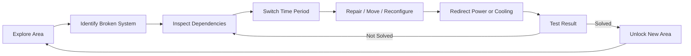
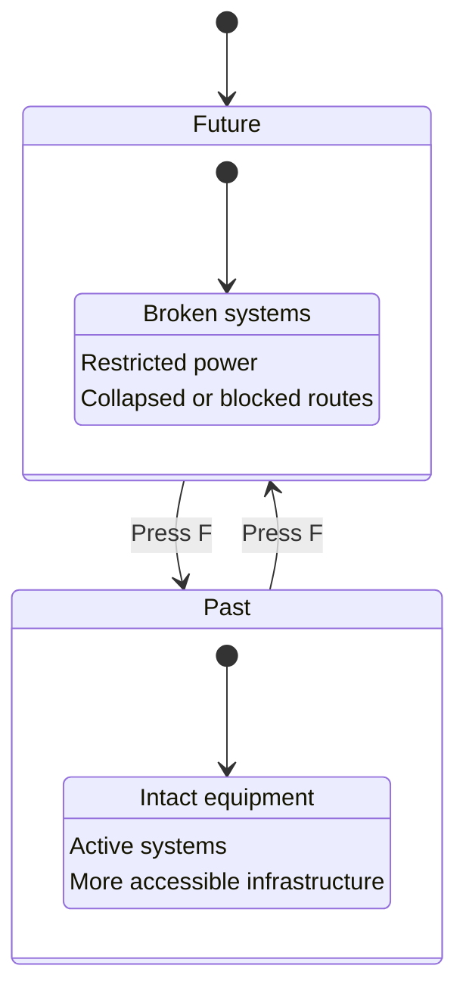
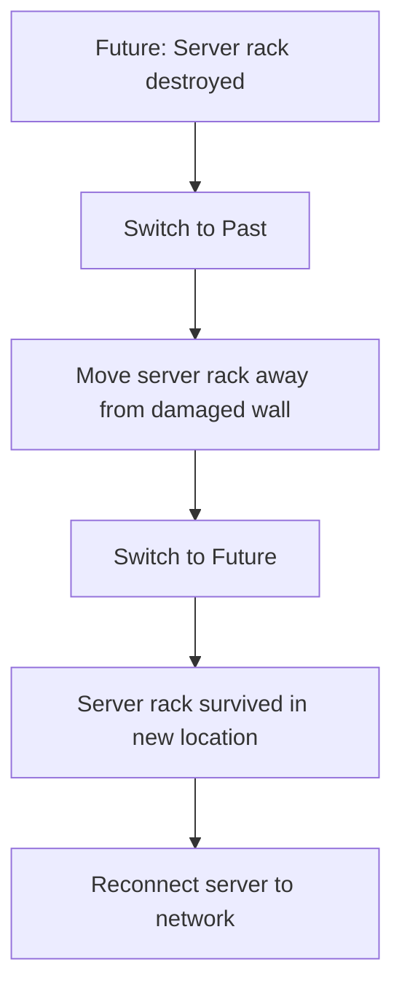
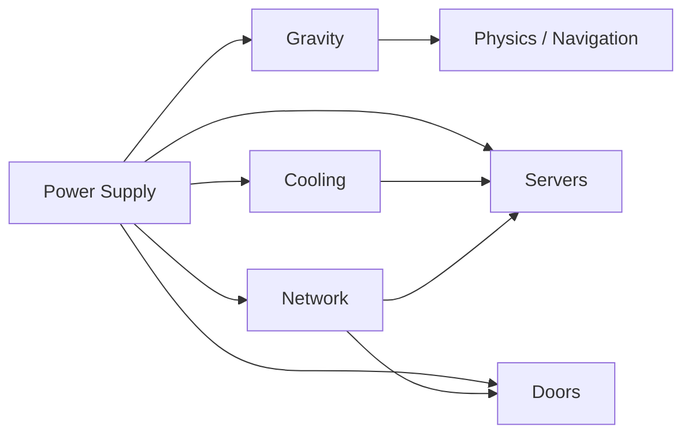
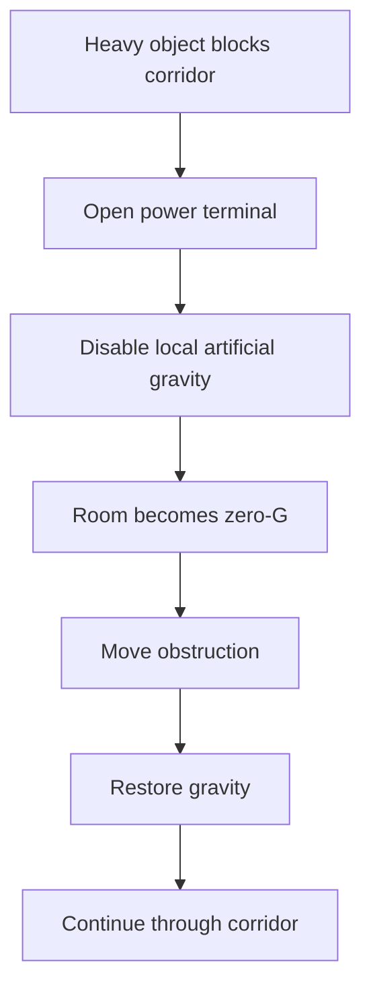
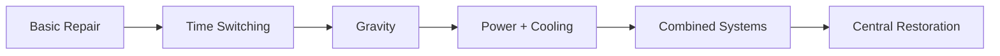
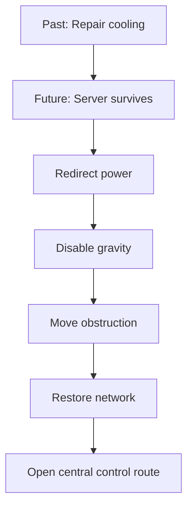
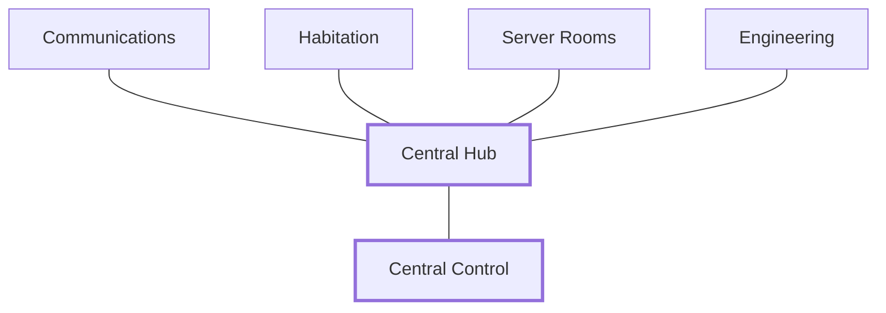

# Game Design Document (GDD)

Current Level 1 implementation: [Engineering Access layout, puzzle walkthrough, validation and editing notes](LEVEL1.md). The playable level uses `Assets/StartScene.unity`; the design below also includes systems planned for later work.


### Table of contents

- [1. Game Overview](#1-game-overview)
- [2. Story and Narrative](#2-story-and-narrative)
- [3. Gameplay and Mechanics](#3-gameplay-and-mechanics)
  - [3.1 Time-Switching System](#31-time-switching-system)
  - [3.2 Power, Cooling and Resource Management](#32-power-cooling-and-resource-management)
  - [3.3 Artificial Gravity](#33-artificial-gravity)
  - [3.4 Progression and Difficulty](#34-progression-and-difficulty)
  - [3.5 Failure and Reset](#35-failure-and-reset)
- [4. Levels and World Design](#4-levels-and-world-design)
  - [4.1 Objects and Interactions](#41-objects-and-interactions)
  - [4.2 Physics](#42-physics)
- [5. Art Direction](#5-art-direction)
  - [5.1 Shaders and Visual Effects](#51-shaders-and-visual-effects)
  - [5.2 Sound and Music](#52-sound-and-music)
  - [5.3 User Interface](#53-user-interface)
  - [5.4 Assets](#54-assets)
- [6. Technology and Tools](#6-technology-and-tools)
- [7. Team Communication, Timeline and Task Assignment](#7-team-communication-timeline-and-task-assignment)
- [8. Possible Challenges and Mitigations](#8-possible-challenges-and-mitigations)
- [9. AI-Generated Concept Art](#9-ai-generated-concept-art)

### 1. Game Overview
**PARALLAX** is a first-person puzzle and exploration game set aboard an abandoned space station approximately 150 years after it was constructed.

The player is a maintenance worker sent to investigate the station and restore its central systems. The station has been offline for decades, and much of its infrastructure has failed. Power is limited, cooling is unstable, artificial gravity is only available in selected areas, doors are locked, network links are broken and large sections of the station are inaccessible.

The player solves these problems by switching between two versions of the same station:

- **Past:** the station is functioning and largely intact, but the player does not directly encounter its former inhabitants.
- **Future:** the station is abandoned, damaged and resource-constrained.

The key rule is that **changes made in the past can alter the future**. Repairing, moving or reconfiguring an object in the past may change its state 150 years later. The player must use this cause-and-effect relationship together with power routing, cooling, networking and artificial gravity to restore the station.

The main objective is to reactivate the station's central systems while discovering why it was abandoned.

## Core Player Experience
The main player experience is built around experimenting with cause and effect across a 150-year time gap. Rather than simply repairing a broken station, the player makes small changes in the past and discovers how they accumulate into much larger consequences over time. The 150-year gap therefore becomes part of the puzzle itself, as players must consider **not only what an action does immediately, but what it could become after more than a century.**

## Player Role

The player controls a maintenance worker sent to inspect the station after it has been offline for an extended period.

The player's responsibilities include:

- repairing damaged systems
- reconnecting power and network infrastructure
- restoring cooling
- controlling local artificial gravity
- moving physical objects
- using terminals
- switching between past and future station states
- recovering historical logs and recordings
- restoring the central control system

The game does not focus on combat. Progress depends on observation, experimentation and understanding how the station's systems interact.

## Genre

**PARALLAX** combines:

- first-person puzzle
- environmental puzzle
- exploration
- physics-based puzzle
- systems-based puzzle
- light narrative mystery

## Target Audience

The target audience is players who enjoy:

- environmental puzzles
- physics-based puzzles
- logical problem solving
- systems that interact with each other
- science-fiction environments
- exploration and environmental storytelling

The intended player should be comfortable with standard first-person movement and basic PC controls. The game is designed to be understandable without requiring experience with complex strategy or simulation games.

---

# 2. Story and Narrative

## Backstory

The station was built around 150 years before the events of the game to support humanity's expansion into space. It acted as both an operational outpost and a repository for important data and knowledge.

For many years, the station supported workers, researchers and technical staff. Its systems relied on a tightly connected network of servers, generators, cooling systems, environmental controls and artificial gravity.

Over time, the station experienced increasing resource restrictions. Power became harder to distribute, cooling capacity fell and critical systems began competing for limited resources. Logs from station workers indicate that failures became more frequent and sections of the station were gradually shut down.

Eventually, the station was abandoned.

The exact reason is not immediately revealed to the player.

When the player arrives 150 years after the station was built, much of the structure still exists, but its systems are badly degraded. The player is sent to determine whether the station can be restored and whether its remaining data can be recovered.

## Narrative Structure

The story is delivered gradually through exploration.

The player discovers:

- maintenance records
- terminal messages
- system alerts
- personal logs
- archived communications
- audio recordings from former workers

These records explain both the technical state of the station and the human decisions that led to its abandonment.

The narrative follows the same order as the player's mechanical progress:

1. **Arrival:** the station appears dead and inaccessible.
2. **Initial restoration:** the player restores basic power and learns that historical data still exists.
3. **Past access:** the player gains the ability to see the station while it was functioning.
4. **System conflict:** records reveal that power and cooling shortages became increasingly serious.
5. **Abandonment:** the player discovers why critical areas were shut down.
6. **Restoration:** the central system is reactivated and the surviving records are recovered.

## Main Character

The player is the only physically present character in the core game.

They are a maintenance worker whose initial goal is practical: inspect the station and restore critical infrastructure.

The player character is intentionally kept visually simple because the game is first-person and the focus is on the environment.

## Former Station Workers

Former workers appear through recordings rather than as live NPCs.

Their messages serve three purposes:

1. explain how systems work;
2. provide clues about puzzle states;
3. reveal what happened before the station was abandoned.

This allows the station to feel inhabited in the past without requiring complex character animation, dialogue systems or AI.

## Main Conflict

The player is trying to restore a system that cannot simply be switched back on.

Every major station subsystem depends on something else:

- servers need power and cooling
- doors need power and network access
- gravity consumes power
- cooling consumes power
- network nodes may be damaged in the future
- physical access changes depending on gravity and time state

The central challenge is therefore not a single broken machine, but an entire station whose systems must be brought back into a stable configuration.

---
# 3. Gameplay and Mechanics

## Player Perspective

The game uses a **3D first-person perspective**.

The camera moves freely with the mouse. The player character is not normally visible on screen.

The first-person perspective keeps interaction direct and makes changes between past and future immediately visible.

## Controls

| Input | Action |
|---|---|
| `W` `A` `S` `D` | Move |
| Mouse | Look |
| `E` / Left click | Interact / grab or release an object |
| `T` | Switch between past and future |
| `Space` | Jump / ascend with jetpack |
| `Ctrl` | Descend with jetpack |
| `Q` | Toggle jetpack |
| `G` | Activate object distortion effect |
| `R` | Reset current puzzle |
| `Esc` / `P` | Pause / settings |

The final controls may be adjusted after playtesting.

## Core Gameplay Loop



The player repeatedly observes a problem, determines what prevents the system from working, switches time period where necessary, changes the environment and tests the new configuration.

## Example Puzzle

The player reaches a locked door in the future.

1. The door has no power.
2. The nearby generator is destroyed.
3. The player switches to the past.
4. The generator is functioning, but its power is allocated to artificial gravity.
5. The player disables gravity in an adjacent room.
6. Enough power becomes available for the door circuit.
7. The player reconnects the door circuit in the past.
8. The player returns to the future.
9. The repaired connection now exists in the future.
10. The door opens.

This example combines the game's three main systems:

- time;
- resource allocation;
- gravity.

---

## 3.1 Time-Switching System

Time switching is the central mechanic.

The player can switch between the station's **past** and **future** states while remaining in approximately the same physical location.



### Past State

The past version of the station is functional and comparatively clean.

Typical characteristics:

- powered equipment
- intact server racks
- active terminals
- connected cables
- working doors
- functional generators
- stable cooling
- full or near-full gravity
- brighter lighting
- fewer physical obstructions

The past gives the player access to equipment that no longer exists in a useful form in the future.

### Future State

The future version is damaged and abandoned.

Typical characteristics:

- broken equipment
- disconnected power
- inactive terminals
- debris
- damaged corridors
- reduced lighting
- limited cooling
- partial or zero gravity
- inaccessible pathways
- exposed cables and machinery

### Cross-Time Persistence

Not every object needs to remember changes across 150 years.

Only selected **persistent puzzle objects** carry changes from the past into the future.

Examples include:

- movable server racks
- power switches
- cables
- network connections
- doors
- selected platforms
- safety barriers
- storage crates

A persistent object can record a small number of important properties, such as:

```text
Position
Rotation
Powered / Unpowered
Connected / Disconnected
Repaired / Broken
Open / Closed
```

This keeps the mechanic understandable and technically manageable.

### Example Cross-Time Interaction


### Long-term Cause and Effect

A key part of the time-switching mechanic is that **small changes made in the past can accumulate into much larger environmental consequences over 150 years.** The long time gap allows minor actions to gradually develop, spread or cause chain reactions, meaning that something insignificant in the past may completely change an area in the future.

Instead of simply using the past and future as two different versions of the same map, the player can make small changes to systems or environmental conditions in the past, then travel 150 years forward to discover how those changes have developed over time.

For example, the player may redirect power to an irrigation system in the past. At first, this only causes plants in the area to begin growing. However, over 150 years, the vegetation may spread throughout the abandoned room. In the future, the overgrown vines could create a new path to an otherwise inaccessible area, while also damaging nearby cooling pipes and creating another problem for the player to solve.
This creates a gameplay loop of **observe → change the past → explore the future consequence → adapt.**

Example: Cause and Effect Across 150 Years 


_AI-generated concept art illustrating the intended long-term environmental changes between the past and future states._

---

## 3.2 Power, Cooling and Resource Management

The station has limited available power.

Major systems consume power:

- artificial gravity
- cooling
- server systems
- doors
- communications
- lighting
- network equipment

The player often cannot power everything at the same time.

### Example Power Budget

| System | Power Cost |
|---|---:|
| Artificial gravity | 40 |
| Cooling | 30 |
| Server bank | 20 |
| Door system | 20 |
| **Total required** | **110** |
| **Available** | **100** |

The configuration above cannot work.

The player could disable gravity:

| System | Power Cost |
|---|---:|
| Artificial gravity | 0 |
| Cooling | 30 |
| Server bank | 20 |
| Door system | 20 |
| **Total required** | **70** |
| **Available** | **100** |

The door and servers can now operate.

### Cooling

Cooling functions as a second resource.

Some systems can receive power but still cannot operate if they are overheating.

Possible rules:

- servers require both power and cooling
- high-load equipment increases heat
- cooling capacity is limited
- damaged future cooling systems are less efficient
- some systems automatically shut down when heat exceeds a threshold

This creates puzzles where simply supplying power is not enough.

### Resource Interaction



The player should be able to understand these relationships through visible cables, terminal diagrams and UI feedback.

---

## 3.3 Artificial Gravity

Artificial gravity is limited by the station's available power.

Gravity can be configured differently in individual puzzle areas.

Possible states:

- **1.0 G — Full gravity**
- **0.5 G — Reduced gravity**
- **0.0 G — Zero gravity**

### Full Gravity

The player and objects behave normally.

Heavy objects may be too difficult to move.

### Reduced Gravity

The player can jump farther and objects become easier to move.

This can be used for navigation or object-placement puzzles.

### Zero Gravity

The player and unrestrained rigidbody objects can float.

This allows:

- moving heavy obstructions
- crossing gaps
- repositioning crates or equipment
- reaching elevated maintenance areas

### Example Gravity Puzzle



Gravity is not only a visual effect. It changes the physical rules of the puzzle.

---

## 3.4 Progression and Difficulty

The game introduces mechanics gradually so the player learns each system before combinations become complex.



### Stage 1 — Basic Repair

The player learns:

- movement
- interaction
- terminals
- basic repair
- reading system status

Example task: reconnect a damaged server cable.

### Stage 2 — Time Switching

The player learns:

- how to switch between past and future
- which objects persist
- how past actions affect future states

Example task: move an object in the past so that it survives in the future.

### Stage 3 — Gravity

The player learns:

- that gravity consumes power
- how reduced gravity affects movement
- how zero gravity affects physical objects

Example task: disable gravity to move a heavy obstruction.

### Stage 4 — Power and Cooling

The player learns:

- that systems share limited resources
- that some systems require both power and cooling
- that enabling one subsystem may disable another

Example task: shut down non-essential equipment to bring a server bank online.

### Stage 5 — Combined Puzzles

The player must combine all previous mechanics.

Example:



### Final Objective

The player reaches the station's central control room.

To complete the game, they must:

- restore stable power
- restore sufficient cooling
- reactivate the server network
- reconnect communications
- stabilise artificial gravity
- bring the central station controller online

The final puzzle requires several systems to operate together and acts as a test of everything introduced earlier.

---

## 3.5 Failure and Reset

**PARALLAX** does not rely on traditional death as the main failure condition.

Instead, the player can create an invalid system configuration.

Possible consequences include:

- circuit overload
- server shutdown
- cooling failure
- gravity loss
- locked doors
- inaccessible platforms
- network disconnection
- overheating equipment

If a puzzle becomes unsolvable, the player can press `R` or use a terminal option to reset the current room to its initial puzzle state.

This encourages experimentation and allows the player to learn how the station works without losing large amounts of progress.

---

# 4. Levels and World Design

The game takes place in a small, connected section of the station rather than an entire open world.

The station is divided into several functional areas:

- central hub
- server rooms
- engineering
- habitation
- communications
- central control

## Proposed Station Layout



The central hub acts as the player's main reference point.

Some routes are initially blocked and become available as systems are restored.

## Central Hub

Purpose:

- connects major station areas
- teaches navigation
- shows global station status
- makes restored systems visibly affect the world

Objects:

- master terminal
- locked doors
- status screens
- power indicators

## Server Rooms

Primary mechanics:

- networking
- cooling
- server restoration
- time-based object positioning

Objects:

- server racks
- network switches
- cooling units
- terminal screens
- cables
- ventilation equipment

## Engineering

Primary mechanics:

- generators
- power routing
- gravity
- physical object manipulation

Objects:

- power generators
- circuit switches
- gravity control equipment
- heavy crates
- maintenance platforms

## Habitation

Primary purpose:

- environmental storytelling
- lower-pressure exploration
- narrative discovery

Objects:

- personal terminals
- storage lockers
- records
- abandoned belongings
- station announcements

## Communications

Primary mechanics:

- network restoration
- final power allocation
- communications equipment

The player may need to restore this area before the central system can transmit a signal.

## Central Control

The final area.

It combines:

- power
- cooling
- server status
- communications
- gravity
- network connectivity

The area should visually change as each subsystem comes online.

---

## 4.1 Objects and Interactions

| Object | Function | Possible States |
|---|---|---|
| Server rack | Stores station data | online, offline, damaged |
| Network switch | Connects systems | connected, disconnected |
| Power switch | Routes electricity | on, off |
| Generator | Supplies power | active, inactive, damaged |
| Cooling unit | Removes heat | active, inactive, damaged |
| Terminal | Controls systems | online, offline |
| Door | Controls access | open, closed, locked |
| Crate / debris | Physics interaction | fixed, movable |
| Gravity controller | Changes local gravity | 1.0 G, 0.5 G, 0.0 G |
| Platform | Navigation | powered, unpowered |
| Cable | Connects equipment | connected, disconnected |
| Audio terminal | Narrative delivery | unread, played |

### Interaction Feedback

Interactable objects should communicate their state clearly.

Examples:

- powered equipment emits light
- inactive equipment is dark
- damaged systems spark or flicker
- connected cables visibly lead to their destination
- overheated systems produce warning effects
- terminals display clear status messages
- interactable objects show a small prompt when targeted

The player should not need to guess whether an action worked.

---

## 4.2 Physics

The game uses Unity's 3D physics system.

Physics are kept intentionally controlled to remain suitable for WebGL.

### Player Physics

The player uses standard first-person movement.

Gravity strength is modified depending on the current room state.

### Object Physics

Selected objects use Rigidbody physics.

Examples:

- crates
- debris
- movable equipment
- lightweight maintenance objects

Most decorative objects remain static to reduce unnecessary physics calculations.

### Zero-Gravity Rules

In zero gravity:

- the player falls very slowly or not at all
- movable rigidbody objects float
- objects preserve momentum until they collide or are stopped
- heavy objects become easier to reposition

Zero-gravity rooms should be small and deliberately designed to avoid uncontrolled physics behaviour.

---

# 5. Art Direction

The art direction is based on a strong contrast between the same station in two different time periods.

## Past — Functional Station

Visual characteristics:

- clean metal surfaces
- intact wall panels
- bright functional lighting
- organised server rooms
- active monitors
- holographic interfaces
- visible status lights
- clean cables and pipes
- controlled cooling effects

The past should feel organised and operational rather than luxurious.


_Past — Functional Station. AI-generated concept art used as a visual reference for the intended art direction._
## Future — Abandoned Station

Visual characteristics:

- darker lighting
- damaged panels
- exposed cables
- broken equipment
- flickering lights
- inactive monitors
- debris
- damaged vents
- visible wear
- occasional cooling vapour or sparks
- overgrown vegetation in selected areas
- environmental changes caused by actions taken in the past

The future must still be readable as the same physical location.


_Future — Abandoned Station. AI-generated concept art showing damaged infrastructure, darker lighting and system failure._


_Future — Environmental Variation. AI-generated concept art exploring vegetation growth, debris and altered physical conditions after 150 years._

## Visual Comparison

| Past | Future |
|---|---|
| Bright | Dark |
| Clean | Damaged |
| Powered | Mostly offline |
| Organised | Debris and obstruction |
| Full system access | Restricted resources |
| Stable gravity | Variable gravity |
| Active terminals | Broken or limited terminals |

## Environment Design Principle

The same modular geometry should be reused between time states wherever possible.

The future version can add:

- damage meshes
- debris
- broken lighting
- altered materials
- disabled objects

This makes the time shift visually strong without requiring two completely separate levels.

---

## 5.1 Shaders and Visual Effects

Shaders are used to make system states easy to understand and to strengthen the difference between time periods.

### Time Transition Effect

When the player switches time period, the environment transitions using a brief visual effect.

Desired Visual Effect:

During the time switch, the environment may briefly distort, dissolve or fragment before revealing the other time state. Lighting and system effects should also change to make the transition between the functional past and abandoned future immediately recognisable.

The transition should be short so repeated switching does not interrupt puzzle solving.

### Hologram Shader

Used for:

- historical recordings
- terminal projections
- station diagrams

Possible properties:

- transparency
- scan lines
- flickering
- emissive glow
- small distortion

### System Status Visual Effects

Equipment changes appearance based on state.

Example visual states:

| State | Visual Feedback |
|---|---|
| Active | emissive lights on |
| Inactive | dark |
| Damaged | flicker / sparks |
| Overloaded | flashing warning |
| Overheating | pulsing warning + heat effect |

### Heat Effect

An overheating shader or particle effect may use:

- heat distortion
- warning emissive materials
- steam or vapour

### Space / Exterior Effects

`StartScene` uses a black starfield and a distant Earth backdrop. Earth is blue, green, and cloud-covered in the past; in the future its oceans and vegetation are gone, leaving a gray-brown surface and a thin dusty atmospheric rim. The planet changes with the existing time switch (`F` / `T`).

The backdrop follows camera position to remain distant while the player moves. `SpaceEnvironment` generates a small star mesh and low-resolution planet textures using built-in Unity materials. The station uses its modular floors for both visuals and collision; the old support plane is disabled. `StationHull` adds reversed exterior faces to the readable kit meshes, preserving both time-state materials, and fills missing wall/roof collision. `StationGravity` derives gravity regions from the actual floor tiles: gravity applies above station decks, while open space is weightless. Gravity switches and the Q jetpack override still apply. Ground checks include the modular decks, walking stops on key release, and jumping requires a new press. Open space automatically uses thrusters. Object grabbing uses world-space camera rays and a local grab anchor, preserves wall collision, and releases on a second interaction or time-state deactivation. See [TESTING.md](TESTING.md) for the combined branch and acceptance checks.

---

## 5.2 Sound and Music

Sound is used as both atmosphere and gameplay feedback.

### Past Ambience

Possible sounds:

- ventilation
- computer fans
- electrical hum
- distant machinery
- terminal beeps
- announcements
- footsteps
- cooling systems

### Future Ambience

Possible sounds:

- weak ventilation
- intermittent electrical sparks
- metal creaks
- distant alarms
- damaged machinery
- silence between system sounds

The future should sound less active than the past.

### Interactive Audio

Important actions receive immediate audio feedback:

- switch toggled
- cable connected
- server activated
- power failure
- overheating warning
- gravity changing
- door opening
- time switch

### Music

Music should be minimal.

Puzzle rooms rely mainly on ambience so the player can hear mechanical feedback clearly.

A subtle musical layer can appear during:

- major discoveries
- central-system restoration
- the ending

---

## 5.3 User Interface

The UI is minimal and uses the visual language of station maintenance software.


### Main Menu

The build opens in `Assets/MainMenu.unity`. **Play** starts a fresh game in `StartScene`, resetting the time period to Future, station gravity, time-switch cooldowns, pause state and cursor capture while keeping saved preferences. **Settings** and **Controls** reuse the existing settings document, with a Back to main menu action. **Quit** exits standalone players; in WebGL it explains that the player should close the browser tab.

The UI Toolkit title screen uses a dark star chart and a procedural orbital-station diagram, with keyboard navigation, visible focus, responsive layout and scrollable overflow. No external visual assets or packages are required. Open `MainMenu` to test the full launch flow; opening `StartScene` directly still supports gameplay and pause/settings testing.

### Settings Menu

The settings menu is available in `StartScene` through the top-right Settings button, `Esc`, or `P`. It pauses gameplay and audio, releases the cursor, and restores the previous pause and cursor state when resumed. The compact, single-column panel supports keyboard navigation and scrolls on smaller screens.

Players can adjust master volume, graphics quality, fullscreen, mouse sensitivity, and vertical-look inversion, or restore defaults. Changes apply immediately and are saved locally on resume. Browser fullscreen requires a click; the visible Settings button and `P` remain available when the browser uses Escape to exit fullscreen.

The menu uses UI Toolkit assets in `Assets/Resources/UI` and persists across scene changes. The prototype player controller reads `GameSettings.MouseSensitivity` and `GameSettings.InvertLook`. Movement, camera look, interactions, and time switching are blocked while settings are open and for the frame that resumes gameplay. In the Editor, fullscreen stores the player preference without changing the Editor window.

Play Mode regression tests are in `Assets/Tests/Settings` and can be run from Unity's Test Runner.

### HUD

The normal HUD can show:

- current time period
- current gravity level
- contextual interaction prompt
- local system warnings

A larger terminal displays detailed power and cooling information.

### HUD Wireframe

```text
┌──────────────────────────────────────────────────────────────┐
│ POWER: 72 / 100            COOLING: 45%                      │
│ NETWORK: OFFLINE           GRAVITY: 0.50 G                   │
│                                                              │
│                                                              │
│                         +                                    │
│                                                              │
│                   [E] Repair Server                          │
│                                                              │
│                                             TIME: FUTURE     │
└──────────────────────────────────────────────────────────────┘
```

### System Terminal Wireframe

```text
┌──────────────────────────────────────────────┐
│ STATION POWER CONTROL                        │
├──────────────────────────────────────────────┤
│ AVAILABLE POWER                  100         │
│                                              │
│ [ON ] COOLING                      30        │
│ [OFF] GRAVITY                       0        │
│ [ON ] SERVER BANK                  20        │
│ [ON ] DOOR SYSTEM                  20        │
│ [OFF] COMMUNICATIONS                0        │
│                                              │
│ CURRENT LOAD                       70 / 100  │
├──────────────────────────────────────────────┤
│ STATUS: STABLE                               │
└──────────────────────────────────────────────┘
```

### UI Design Goals

The UI should be:

- readable
- simple
- consistent with the station aesthetic
- useful for puzzle reasoning
- visible without covering too much of the environment

Status changes should be communicated through both UI and environmental feedback.

---

## 5.4 Assets

The project uses a modular asset strategy.

The aim is to keep the environment visually consistent while avoiding unnecessary asset complexity.

### Required Asset Categories

| Asset Category | Intended Use | Source Plan |
|---|---|---|
| Modular sci-fi walls | corridors and rooms | Unity Asset Store or team-created |
| Floors and ceilings | station environment | Unity Asset Store or team-created |
| Server racks | server rooms | Unity Asset Store / free 3D asset source |
| Terminals | system interaction | Unity Asset Store / team-created |
| Crates and debris | physics puzzles | Unity Asset Store / team-created |
| Cables and pipes | visual system links | team-created simple meshes or sourced pack |
| Generator equipment | engineering | sourced 3D asset or modified primitive |
| Cooling equipment | server/engineering rooms | sourced or team-created |
| Space skybox | station windows | Unity Asset Store |
| Alarm / machinery audio | environmental sound | royalty-free audio source |
| UI icons | maintenance interface | team-created or free icon source |

### Candidate Sources

Candidate sources include:

- Unity Asset Store — https://assetstore.unity.com/
- Kenney — https://kenney.nl/assets
- Poly Haven — https://polyhaven.com/
- OpenGameArt — https://opengameart.org/
- Freesound — https://freesound.org/

Before importing external assets, the team will check the asset licence and record the source.

### Asset Selection Rules

Assets should be:

- compatible with Unity
- lightweight enough for WebGL
- visually consistent
- legally usable for the project
- easy to modify where necessary

Large high-resolution assets will be avoided unless they materially improve the scene.

---

# 6. Technology and Tools

| Tool / Technology | Purpose |
|---|---|
| **Unity 6.3 LTS** | Game engine |
| **C#** | Gameplay and systems programming |
| **Unity Physics** | Player and object physics |
| **Unity Shader system** | Time transitions, holograms and environmental feedback |
| **Unity WebGL** | Final browser build |
| **Git** | Version control |
| **GitHub** | Shared repository, pull requests and code review |
| **GitHub Issues / Projects** | Task tracking |
| **Markdown** | Game Design Document |
| **Blender (optional)** | Simple mesh editing if required |
| **Figma / image editor (optional)** | UI mock-ups and simple graphics |
| **Audacity (optional)** | Editing audio clips |

Unity and GitHub are the core development tools. Optional tools will only be used where they reduce workload rather than adding unnecessary complexity.

---

# 7. Team Communication, Timeline and Task Assignment

## Communication

The team will use English for all project-related communication.

Primary communication channels:

- GitHub Issues for trackable development tasks;
- GitHub pull requests for code review and merging;
- team messaging / group chat for quick discussion;
- scheduled team meetings for design decisions and integration.

Important technical or design decisions should be recorded in GitHub issues, pull requests or the README so they are not lost in temporary chat messages.

## Development Timeline

### Phase 1 — Prototype

Goals:

- first-person movement
- interaction
- one simple repair
- basic past/future switch
- test WebGL build

### Phase 2 — Core Systems

Goals:

- persistent time-state objects
- power allocation
- cooling
- gravity controls
- basic UI

### Phase 3 — Puzzle Rooms

Goals:

- server room puzzle
- engineering / gravity puzzle
- central hub
- combined puzzle

### Phase 4 — Presentation

Goals:

- lighting
- shaders
- time transition
- sound
- narrative logs
- environmental detail

### Phase 5 — Integration and Testing

Goals:

- connect all rooms
- test progression
- fix soft locks
- improve puzzle clarity
- optimise WebGL performance

### Phase 6 — Final Polish

Goals:

- bug fixing
- UI refinement
- final audio
- final WebGL build
- documentation updates

---

# 8. Possible Challenges and Mitigations

## 1. Synchronising Past and Future

**Challenge:**  
Allowing too many objects to persist across time could make the system difficult to implement and debug.

**Mitigation:**  
Only specifically marked puzzle objects persist. Each stores a limited set of state variables.

---

## 2. Switching Entire Environments

**Challenge:**  
Keeping two complete versions of each room active could increase memory usage.

**Mitigation:**  
Reuse base geometry and enable only the objects, materials, lights and damage elements required for the active time state.

---

## 3. Artificial Gravity Physics

**Challenge:**  
Changing gravity while rigidbody objects are moving may produce unpredictable results.

**Mitigation:**  
Use gravity only in controlled puzzle rooms, restrict the number of active physics objects and prototype this mechanic early.

---

## 4. Resource System Complexity

**Challenge:**  
Power, cooling, networking and gravity could become difficult for players to understand.

**Mitigation:**  
Use clear terminal diagrams, visible cables, status lights, sound and simple numerical resource values.

---

## 5. Puzzle Soft Locks

**Challenge:**  
The player may move an object or configure a system in a way that makes the puzzle impossible to complete.

**Mitigation:**  
Every puzzle area includes a reset option that restores the room to a valid starting state.

---

## 6. Scope

**Challenge:**  
Time switching, physics, multiple station systems, narrative and shader effects create a large potential scope.

**Mitigation:**  
Prioritise a small number of polished rooms. Extra rooms, complex narrative content and optional effects are secondary to the core mechanics.

---

## 7. WebGL Performance

**Challenge:**  
Shaders, multiple room states and physics may perform differently in WebGL compared with the Unity editor.

**Mitigation:**  
Create WebGL builds early, use low-cost assets and effects, and keep active physics objects limited.

---

## 8. Visual Clarity

**Challenge:**  
The player may not immediately understand whether they are in the past or future.

**Mitigation:**  
Use clear differences in lighting, sound, material condition, system activity and HUD state.


## 9. AI-Generated Concept Art
Some concept images in this document were generated using OpenAI's ChatGPT image generation tools. These images are used solely as visual references to communicate the intended art direction, atmosphere and gameplay concepts. They do not represent final in-game assets or screenshots.

---

## Audio planning

[PARALLAX — 第一版音效选型与处理清单](AUDIO_SELECTION_V1.md) records the current candidates, processing requirements and source paths. Direct listening and in-game mixing verification are still pending.
